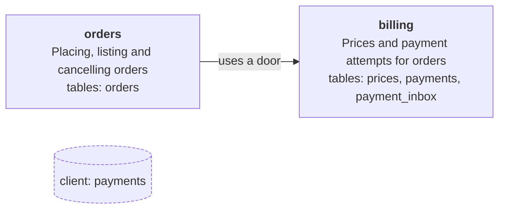

# Architecture at a glance

Generated from `architecture.json` by `pnpm arch:diagram`. CI fails when this diagram is stale,
so it cannot drift from the policy the checks enforce.

Solid arrows are declared module edges (the caller uses the callee's `server.ts`). Dashed arrows
are declared read exceptions. Cylinders are third-party ports under `src/clients`. Every table has
one owning module.

<!-- architecture-diagram:start -->

<!-- architecture-diagram:end -->

The rules behind the diagram are in [ARCHITECTURE.md](../../ARCHITECTURE.md) (sections 4, 5, 7, 11).
